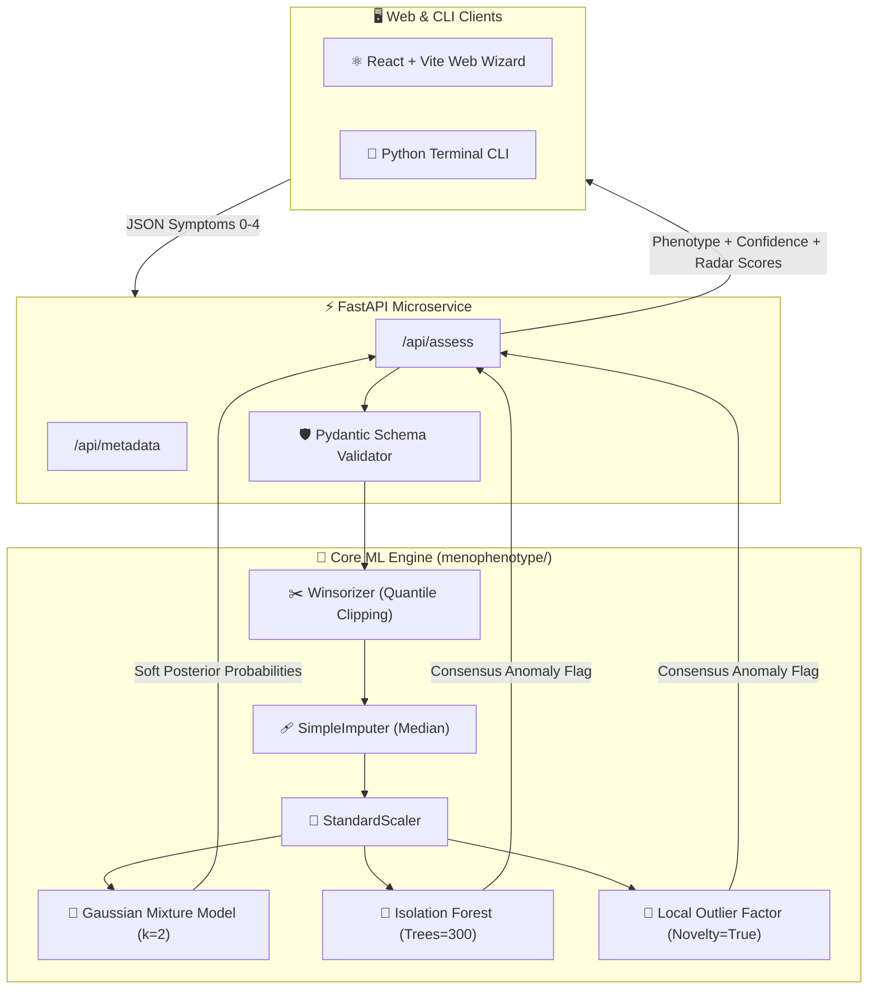

<div align="center">

```
  __  __                  _____  _                      _                     
 |  \/  |                |  __ \| |                    | |                    
 | \  / | ___ _ __   ___ | |__) | |__   ___ _ __   ___ | |_ _   _ _ __   ___  
 | |\/| |/ _ \ '_ \ / _ \|  ___/| '_ \ / _ \ '_ \ / _ \| __| | | | '_ \ / _ \ 
 | |  | |  __/ | | | (_) | |    | | | |  __/ | | | (_) | |_| |_| | |_) |  __/ 
 |_|  |_|\___|_| |_|\___/|_|    |_| |_|\___|_| |_|\___/ \__|\__, | .__/ \___| 
                                                              __/ | |         
                                                             |___/|_|         
```

### 🌸 *Decoding Menopausal Symptom Dynamics through Unsupervised Machine Learning* 🌸
#### *Where Clinical Epidemiology Meets Algorithmic Serenity* ✨🔮

---

[](https://python.org)
[](https://scikit-learn.org)
[](https://fastapi.tiangolo.com)
[](https://react.dev)
[](https://www.icpsr.umich.edu)
[](https://opensource.org/licenses/MIT)

[✨ Overview](#-the-grand-vision) • 
[🧬 The Phenotypes](#-the-phenotypes-a-tale-of-two-clusters) • 
[🌌 The 14-Stage Odyssey](#-the-14-stage-research-odyssey) • 
[⚡ Quickstart](#-instant-gratification-quickstart) • 
[🧪 Interactive Assessment](#-interactive-self-assessment-demo) • 
[🔮 Architecture](#-celestial-pipeline-architecture) • 
[📜 Ethics](#-sacred-clinical--ethical-disclaimer)

---

</div>

> *"Biology doesn't draw sharp borders; it weaves tapestries of overlapping rhythms."*  
> Welcome to **MenoPhenotype** — an end-to-end Machine Learning ecosystem discovering empirical symptom archetypes from the landmark **Study of Women's Health Across the Nation (SWAN)** dataset. We turned 3,300+ clinical interviews, 18 nuanced Likert symptom markers, and sophisticated mixture models into an interactive, deployable diagnostic playground. Heheheheh! 🚀

---

## 🌟 The Grand Vision

Menopause isn't a single checkbox or a monolithic experience. It's a high-dimensional symphony of vasomotor ripples, psychological shifts, somatic tensions, and nocturnal interruptions. 

Instead of forcing arbitrary clinical cutoffs, **MenoPhenotype** lets unsupervised probabilistic learning (Gaussian Mixture Models) listen to the data. What emerged? Two distinct clinical archetypes and an elusive band of multi-signal outliers that defy simple categorization.

```
                  ┌─────────────────────────────────────┐
                  │ 16,000+ Screened Midlife Individuals│
                  └──────────────────┬──────────────────┘
                                     │ Filtered to
                                     ▼
                  ┌─────────────────────────────────────┐
                  │  3,290 SWAN Longitudinal Cohort     │
                  └──────────────────┬──────────────────┘
                                     │ Unsupervised Clustering
                        ┌────────────┴────────────┐
                        ▼                         ▼
            🌿 PHENOTYPE A (74.7%)     ⚡ PHENOTYPE B (25.3%)
             "The Gentle Ripple"       "The Multi-Domain Tempest"
                        │                         │
                        └────────────┬────────────┘
                                     │ Outlier Consensus
                                     ▼
                         🌌 ATYPICAL PROFILES (5.6%)
                           "The Cosmic Wanderers"
```

---

## 🧬 The Phenotypes: A Tale of Two Clusters

<div align="center">

| Attribute | 🌿 **Phenotype A** *(The Gentle Ripple)* | ⚡ **Phenotype B** *(The Cosmic Storm)* | 🌌 **The Atypical Wanderer** |
|:---:|:---:|:---:|:---:|
| **Sample Size** | **2,457 women** (~74.7%) | **833 women** (~25.3%) | **183 women** (~5.6% overlap) |
| **Symptom Signature** | Muted, localized, low daily frequency | High multi-domain burden simultaneously | Defies density; extreme cross-domain variance |
| **Top Discriminators** | Low cold sweats, mild night flushes | Elevated cold sweats (32% RF split!), severe sleep fragmentation | Dual-flagged by Isolation Forest + LOF |
| **Endocrine Biomarkers** | Higher SHBG, higher DHEA-S | Lower SHBG, lower DHEA-S, higher BMI | Highly heterogeneous hormonal trajectory |
| **Model Character** | Cohesive high-density Gaussian sphere | Elongated high-burden multivariate tail | Sparse novel territory in ℝ¹⁸ |

</div>

<details>
<summary><b>🔍 Click here to peek behind the statistical curtain</b></summary>
<br>

> 💡 **Why GMM beat K-Means & Agglomerative Hierarchical Clustering:**
> While Ward's Agglomerative Clustering yielded a higher crisp silhouette score (*0.426* vs GMM's *0.267*), real human biology doesn't do "hard borders." A woman transitioning between phases doesn't snap like a boolean switch! GMM supplies **soft posterior probabilities** (`confidence: 0.842`), acknowledging the beautiful gradients of physiology.

</details>

---

## 🌌 The 14-Stage Research Odyssey

From raw Stata punchcards to production-grade scikit-learn transformers, explore the journey:

```
[01. EDA] ──► [02. Quality Check] ──► [03. Feature Eng] ──► [04. Train/Test Split]
                                                                     │
[08. Model Sweeps] ◄── [07. Baseline] ◄── [06. Feature Select] ◄── [05. Preprocess]
        │
        ▼
[09. Hyper Tuning] ──► [10. Evaluation] ──► [11. Outlier Analysis] ──► [12. Interpretation]
                                                                               │
[14. Grand Finale] ◄─────────────────────────────────────────────────── [13. Inference Demo]
```

<details>
<summary><b>🗺️ Expand the Comprehensive Stage Breakdown</b></summary>

1. **`MenoPhenotype_01_EDA.ipynb`**: Deciphering the 741 features of ICPSR Study 28762.
2. **`MenoPhenotype_02_DataQualityCheck.ipynb`**: Banishing survey sentinels (`Missing`, `Do Not Know`) & zero-variance hormone flags.
3. **`MenoPhenotype_03_FeatureEngineering.ipynb`**: Reverse-scoring CESD depression items & engineering the waist-to-hip ratio (`WHR`).
4. **`MenoPhenotype_04_TrainTestSplit.ipynb`**: 80/20 train/test stratified partition on menopausal status (`STATUS0`) — *Zero leakage tolerated!*
5. **`MenoPhenotype_05_Preprocessing.ipynb`**: Handcrafting the custom `Winsorizer` & fitting median imputers strictly on training data.
6. **`MenoPhenotype_06_FeatureSelection.ipynb`**: Hopkins statistic clusterability test & VIF collinearity pruning to select **Feature Set A (18 Symptoms)**.
7. **`MenoPhenotype_07_BaselineModel.ipynb`**: Untuned k=2 K-Means establishing the performance benchmark floor.
8. **`MenoPhenotype_08_ModelSelectionTraining.ipynb`**: Grid sweep across K-Means, Agglomerative, GMM, and DBSCAN.
9. **`MenoPhenotype_09_HyperparameterTuning.ipynb`**: Bootstrap stability evaluation (ARI > 0.89) & Bayesian Information Criterion minimization.
10. **`MenoPhenotype_10_ModelEvaluationComparison.ipynb`**: Scoring unseen test split with nearest-centroid mapping.
11. **`MenoPhenotype_11_ErrorAtypicalProfileAnalysis.ipynb`**: Dual-threat anomaly consensus with Isolation Forests & Local Outlier Factors.
12. **`MenoPhenotype_12_Interpretation.ipynb`**: Demystifying feature importances via Random Forest rules & Bonferroni-corrected bio-marker audits.
13. **`MenoPhenotype_13_FinalDemonstration.ipynb`**: Birth of `demo_self_assessment.py` for real-time scoring.
14. **`MenoPhenotype_14_Conclusion.ipynb`**: Executive synthesis and scientific retrospectives.

</details>

---

## ⚡ Instant Gratification: Quickstart

### 🐳 1. Single-Command Docker Deployment (Recommended)

Zero host dependencies required! Launches the unified production container (Node-compiled React SPA + FastAPI backend) on port `8000`:

```bash
# Clone the repository
git clone https://github.com/sharancreates/menopause-detection-from-phenotype.git
cd menopause-detection-from-phenotype

# Build and launch in one command
docker compose up --build
```

- 🌐 **Interactive Web Questionnaire & Dashboard**: Open [http://localhost:8000](http://localhost:8000)
- 📖 **Interactive OpenAPI / Swagger Documentation**: Open [http://localhost:8000/docs](http://localhost:8000/docs)
- 🩺 **Container Health Probe**: `curl http://localhost:8000/api/health`

---

### 💻 2. Local Python & Node Development

If you prefer running directly on your host machine:

#### Backend Microservice (FastAPI + Uvicorn)
```bash
# Install Python dependencies
pip install -r requirements.txt

# Ensure models are serialized in artifacts/
python export_artifacts.py

# Launch FastAPI ASGI server on port 8000
uvicorn main:app --reload --port 8000
```

#### Frontend Single Page Application (React + Vite)
```bash
cd frontend
npm install
npm run dev
# Vite dev server starts on http://localhost:5173 with proxy forwarding /api to :8000
```

#### Run All Automated Tests
```bash
# 31 unit, transformer, inference, and API integration tests
python -m pytest tests/ -v

# Validate frontend production build
npm run build --prefix frontend
```

---

## 📡 REST API Reference

| Method | Endpoint | Description | Sample Request / Response |
|:---:|:---|:---|:---|
| `GET` | `/api/health` | Health probe & model cache status | Returns `{"status": "healthy", "models_loaded": true, "artifact_count": 6}` |
| `GET` | `/api/metadata` | 18 symptoms, 4 domains, and Likert scale | Full codebook and clinical domain mapping |
| `POST` | `/api/assess` | Score symptom dictionary against ML pipeline | Accepts JSON `{"HOTFLAS0": 3, ...}`, returns phenotype, confidence, and outlier status |
| `GET` | `/docs` | Interactive OpenAPI / Swagger UI | Interactive API exploration and test playground |

---

## 🧪 Interactive Self-Assessment Demo

Experience how the inference engine evaluates a multi-domain symptom input:

```python
from menophenotype import assess

# 0: Not at all | 1: 1-5 days | 2: 6-8 days | 3: 9-13 days | 4: Every day
my_symptoms = {
    "HOTFLAS0": 3,   # Hot flashes
    "COLDSWE0": 4,   # Cold sweats (top decision driver!)
    "SWEATS0":  3,   # Night sweats
    "WAKENI0":  4,   # Waking during the night
    "TIRED0":   2,   # Fatigue / exhaustion
    "TENSE0":   1,   # Irritability / nervous tension
    "HEADAC0":  0,   # Headaches
    "DRYVAG0":  2    # Vaginal dryness
}

result = assess(my_symptoms)
print(f"✨ Match: {result['phenotype']}")
print(f"🔮 Confidence: {result['confidence'] * 100:.1f}%")
print(f"🛸 Atypical Profile: {'YES - Unique pattern!' if result['atypical_flag'] else 'NO - Classic trajectory'}")
```

---

## 🔮 Celestial Pipeline Architecture



---

## 🎭 Meet the 18 SWAN Symptoms

Curious what features do the heavy lifting? Here is the complete quartet of biological domains:

<details>
<summary><b>🔥 1. Vasomotor Domain (The Thermal Rollercoaster)</b></summary>

- `HOTFLAS0`: Sudden surges of heat spreading across chest and face
- `COLDSWE0`: Cold sweat episodes (*the #1 mathematical split boundary!*)
- `SWEATS0`: Waking soaked in nocturnal night sweats
</details>

<details>
<summary><b>💤 2. Sleep & Rest Domain (The Nocturnal Clock)</b></summary>

- `FALLAS0`: Difficulty falling asleep
- `WAKENI0`: Frequent waking during the night
- `WAKEEA0`: Awakening early in the morning unable to return to sleep
</details>

<details>
<summary><b>⚡ 3. Somatic & Physical Domain (The Body Electric)</b></summary>

- `ACHING0`: Joint pain, stiffness, or muscle soreness
- `BREATH0`: Shortness of breath or breathlessness
- `HEADAC0`: Pounding headaches or migraines
- `TIRED0`: Deep exhaustion or sluggish fatigue
- `SORE0`: Breast tenderness or discomfort
- `DRYVAG0`: Vaginal dryness
- `LEAKUR0`: Involuntary bladder leakage
</details>

<details>
<summary><b>🧠 4. Psychological & Affective Domain (The Mindscape)</b></summary>

- `DIZZY0`: Sensations of lightheadedness or dizziness
- `HARTBOU0`: Heart pounding or racing episodes
- `SHAKIN0`: Internal trembling or shaking sensations
- `TRMBLE0`: Trembling in the hands or limbs
- `TENSE0`: Feeling tense, irritable, or nervous
</details>

---

## 📜 Sacred Clinical & Ethical Disclaimer

<div align="center">

> [!WARNING]
> ### 🩺 This is a machine learning tool, NOT a medical doctor!
> 
> **MenoPhenotype** was created for algorithmic research, symptom pattern recognition, and educational discovery. It is **explicitly NOT** a clinical diagnostic instrument, medical advice engine, or treatment prescription system.
> 
> Every body is a universe with its own rhythm. If you are experiencing symptoms affecting your daily life, wellbeing, or serenity, **please consult a qualified gynecologist, endocrinologist, or trusted healthcare professional.** 💖

</div>

---

<div align="center">

Crafted with curiosity, scientific rigor, and a touch of cosmic magic ✨  
*© 2026 MenoPhenotype Team • Empowering midlife health through explainable machine learning.*

`Stay cool, stay curious, and keep clustering!` 🌿🛸

</div>